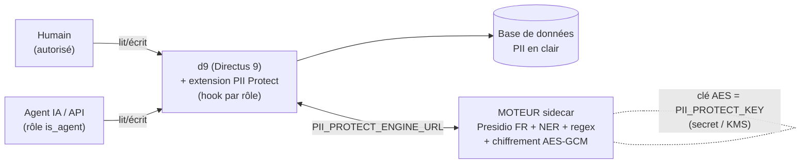

# Architecture — d9 PII Protect

Deux briques, découplées par une variable d'environnement. **Un moteur par environnement**
(dev / staging / prod) : pas de proxy central, les PII ne sortent jamais de leur environnement
(principe de confinement).

```
                        ENVIRONNEMENT (dev / staging / prod)
  ┌──────────────────────────────────────────────────────────────────────────┐
  │                                                                            │
  │   Agent IA / API ─────────┐                                                │
  │   (rôle "is_agent")        │  lit/écrit des items & fichiers               │
  │                            ▼                                                │
  │                    ┌───────────────┐   PII_PROTECT_ENGINE_URL   ┌────────┐ │
  │   Humain ─────────▶│      d9       │ ─────────────────────────▶ │ MOTEUR │ │
  │   (voit en clair)  │  (Directus 9) │ ◀───────────────────────── │(sidecar)│ │
  │                    │  + extension  │     texte <-> marqueurs     └────────┘ │
  │                    │  PII Protect  │                             Presidio FR │
  │                    └───────┬───────┘                             + NER FR    │
  │                            │                                     + regex     │
  │                            ▼                                     + AES-GCM    │
  │                      Base de données                             (clé = env)  │
  │                      (PII EN CLAIR, protégée par le RBAC)                     │
  └──────────────────────────────────────────────────────────────────────────┘
```



## Qui fait quoi

| Brique | Rôle | Techno | Contenu du repo |
|---|---|---|---|
| **Moteur** (`engine/`) | Détecte les PII dans un texte et les chiffre/déchiffre. Réutilisable par n'importe quel service, pas seulement d9. | Python, [Presidio](https://microsoft.github.io/presidio/) (orchestration) + NER FR [Anonym-IA](https://huggingface.co/Anonym-IA/V2-camembert-ner-pii-french) + recognizers regex/checksum + AES-256-GCM maison | `Dockerfile`, `app.py`, `analyzer.py`, `recognizers.py`, `ner.py`, `crypto.py`, `MODELS.md` |
| **Extension** (`extension/`) | Intègre le moteur dans d9 en un hook. Anonymise à la lecture pour les rôles « agent », réhydrate à l'écriture, et pour les humains autorisés. | TypeScript (hook Directus) | `src/index.ts`, `dist/index.js` |
| **Déploiement** (`deploy/`) | Stack de référence qui câble les deux. | docker-compose | `docker-compose.yml`, `.env.example` |

## Le flux, pas à pas

1. Un **agent** (rôle avec `is_agent = true`) lit un item. Le hook d9 appelle `POST /anonymize`
   sur le moteur pour chaque champ libre concerné.
2. Le moteur **détecte** les PII (NER FR + regex + scoring contextuel Presidio) et remplace
   chaque valeur par un marqueur chiffré `[[PII:TYPE:base64(nonce+ciphertext)]]`.
   → l'agent ne voit **jamais** la donnée en clair ; un nonce aléatoire par valeur empêche toute
   fuite d'égalité ou attaque par force brute sans la clé.
3. L'agent **écrit** (create/update) un texte contenant des marqueurs. Le hook appelle
   `POST /rehydrate` : le moteur **déchiffre** et restaure le clair avant stockage.
4. Un **humain autorisé** lit normalement : pas d'anonymisation (le RBAC d9 décide qui est autorisé).
5. **Fail-closed** : si le moteur est injoignable, l'agent reçoit `[protégé — indisponible]`
   plutôt que la donnée en clair.

## Décisions de conception

- **Secure-by-default** : sans configuration, tous les champs de type `text` sont protégés pour les
  rôles agent. Le RBAC couvre déjà les champs structurés ; nous couvrons les **champs libres**,
  là où une PII imprévue peut se glisser. On peut ensuite restreindre par champ
  (`PII_PROTECT_FIELDS`) et par type de PII (`PII_PROTECT_ENTITIES` / `PII_PROTECT_SKIP`).
- **Chiffrement réversible, pas masquage** : on ré-identifie pour les humains autorisés.
  La custody de la clé (`PII_PROTECT_KEY`) **est** la frontière de sécurité.
- **Presidio embarqué, pas from scratch** : on réutilise son registry de recognizers et son
  scoring contextuel (qui désambiguïse p. ex. SIREN vs NIR), et on garde **notre** chiffrement
  (le `hash` de Presidio, non salé, est insuffisant).
- **Un moteur par environnement** : confinement. Pas de proxy central par lequel transiteraient
  les données de tous les environnements.
- **Pas de logs custom** : l'activité est déjà tracée par l'**audit d9** natif.

## Points personnalisables (flaggés dans le code)

- Ajouter une **regex** / un recognizer → `engine/recognizers.py` (bloc « AJOUTER UN RECOGNIZER »).
- Changer le **modèle NER** (autre langue, autre modèle) → env `PII_NER_MODEL`, voir `engine/MODELS.md`.
- Choisir **quels types** sont chiffrés → `PII_PROTECT_ENTITIES` / `PII_PROTECT_SKIP`.
- Choisir **quels champs** sont traités → `PII_PROTECT_FIELDS`.
