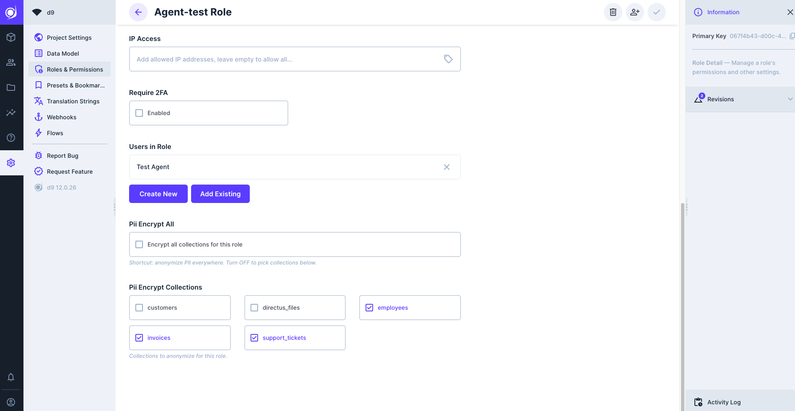

# d9 PII Protect

Governed PII anonymization for AI agents in [d9](https://github.com/LaWebcapsule/d9) (Directus 9).

For the roles you choose, PII in **free-text fields, documents and images** is **reversibly encrypted**
(or redacted for images) on read; authorized users still see the original. Detection is French-first
(Presidio + a FR NER model) and runs in a self-contained engine next to d9 — PII never leaves your
environment. Structured fields stay handled by d9's usual permissions.

## Install

Add it to an **existing d9** — see [`extension/README.md`](extension/README.md) — or run the reference
stack from scratch:

```bash
cd deploy
cp .env.example .env            # set at least PII_PROTECT_KEY
docker compose up -d --build    # d9 on http://localhost:8055 + the PII engine
```

## Use it

Open **Settings → Roles & Permissions → a role**. The extension adds two controls there automatically
(no setup script):



- **Encrypt all collections for this role** — anonymize PII everywhere, or
- turn it off and **tick the specific collections** to anonymize.

Users in that role then read the selected collections with PII encrypted (`[[PII:…]]` markers, reversible);
anyone whose role isn't configured sees the clear value. It applies to **any role, humans included**, so you
can also hide data from some human maintainers. Changing these controls requires role-edit rights, so a
regular user can't alter what's encrypted.

## Configuration (environment variables)

| Variable | Where | What | Default |
|---|---|---|---|
| `PII_PROTECT_KEY` | engine | **AES-256 key** (use a secret/KMS in production). | — (required) |
| `PII_PROTECT_ENGINE_URL` | extension | URL of the engine. | `http://engine:8077` |
| `PII_PROTECT_FIELDS` | extension | JSON `{collection:[fields]}` to restrict which fields. Empty = all `text` fields. | *(empty)* |
| `PII_PROTECT_ENTITIES` / `PII_PROTECT_SKIP` | engine | Allow-list / deny-list of PII types to encrypt. | *(empty = all)* |
| `PII_NER_MODEL` | engine | Hugging Face NER model (see [`engine/MODELS.md`](engine/MODELS.md)). | Anonym-IA FR |
| `PII_NER_THRESHOLD` | engine | NER confidence threshold. | `0.4` |
| `PII_NER_ONNX_THREADS` | engine | ONNX Runtime threads (empty = auto; cap to perf cores on Apple Silicon). | *(auto)* |
| `PII_OCR_LANG` | engine | Tesseract language for image redaction. | `fra` |

## Customize

- Add a regex / recognizer → `engine/recognizers.py`.
- Change language / model → `PII_NER_MODEL` (candidates in `engine/MODELS.md`).
- Choose which PII types → `PII_PROTECT_ENTITIES` / `PII_PROTECT_SKIP`.

Architecture overview: [`ARCHITECTURE.md`](ARCHITECTURE.md).

## License

MIT — see [LICENSE](LICENSE).
